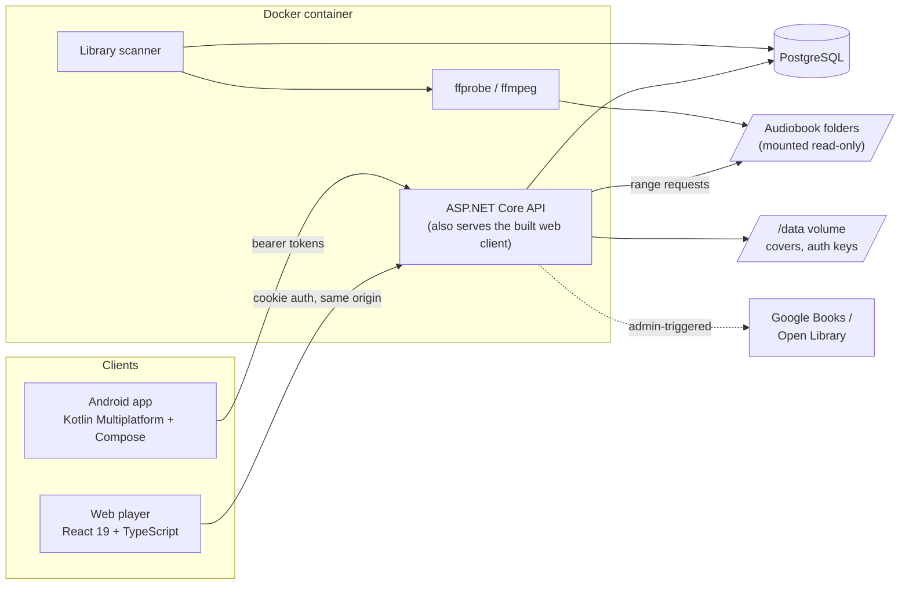

# AudiobookServer

A self-hosted audiobook server with a web player and an Android app. Point it at a
folder of audiobooks; it indexes them, streams them, and keeps your place in sync
across every device you listen on.

**.NET 10 · PostgreSQL · React 19 · Kotlin Multiplatform · Docker**

<!-- Screenshot or short recording of the library page and the sync "jump" offer goes here. -->

## Why

Jellyfin is great for video you own, but it was never built for audiobooks.
Audiobookshelf fills that space, and one of its most reported weak spots is progress:
positions lost, or overwritten by an older one, when you switch devices. This project is
built around getting that one thing right: **your position is a single number on a
single timeline, and the server settles conflicts with explicit, tested rules.**

## Features

- **Library scanning** of mp3 and m4b, single-file or multi-file, including multi-disc
  sets (`CD 01`, `Disc 2`, …) and folders holding several books (split by `album` tag).
- **Exact durations**: mp3 files are frame-counted, not estimated from the header (see
  [the mp3 drift investigation](#the-mp3-duration-drift)).
- **Chapters** from embedded markers, placed on one book-wide timeline; a chapter can
  span a file boundary.
- **Streaming** with HTTP range requests (seek anywhere, resume downloads).
- **Position sync** between browsers and phones, with a "another device is ahead —
  jump there?" offer instead of silently moving you.
- **Covers** (largest of folder art and embedded art) with on-demand phone thumbnails;
  **blurbs** fetched from Google Books or Open Library.
- **Accounts**: admin-created, temporary passphrase, forced change on first sign-in.
  Libraries are private or public, and private ones can be granted per account.
- **Admin page** for listeners, libraries, scans and metadata corrections, plus an
  `admin` command for the server shell (the recovery path when you're locked out).
- **Web player**: shelves home page, author pages, search and sort, chapter-aware
  player, volume, works on phones.
- **Android app**: background playback with lock-screen controls (Media3), offline
  downloads, speed, sleep timer, the same sync rules as the web.

## Architecture



| Project | What's in it |
|---|---|
| [`src/AudiobookServer.Core`](src/AudiobookServer.Core) | Domain and data: entities, EF Core migrations, the scanner, media probing, timeline maths, sync rules, metadata. No web dependencies. |
| [`src/AudiobookServer.Api`](src/AudiobookServer.Api) | Minimal-API endpoints, auth, visibility, the `admin` command. `Program.cs` only wires things up. |
| [`tests/AudiobookServer.Tests`](tests/AudiobookServer.Tests) | xUnit unit tests, plus integration tests against a real Postgres via Testcontainers. |
| [`web`](web) | The browser client (Vite, React Router, Vitest). |
| [`mobile`](mobile) | Kotlin Multiplatform: `sharedLogic` (API client, sync, downloads, timeline), `sharedUI` (Compose Multiplatform), `androidApp`, and an iOS shell for later. |
| [`docs`](docs) | The [API contract](docs/api-contract.md), the generated [`openapi.json`](docs/openapi.json), and design notes in [`docs/next-steps`](docs/next-steps). |

### The data model in one paragraph

A **library** is a folder. A **book** is a folder inside it (or one album within a
folder). A book has **files** and **chapters**, both positioned on the book's single
timeline by `StartOffsetSeconds`. A **playback position** is one row per user per book.
Files and chapters are derived data, replaced wholesale on every rescan; only the book
row is stable, so positions, metadata overrides and blurbs survive rescans. Streams are
addressed by `(bookId, sequence)` rather than file ID for the same reason.

## Design decisions

The interesting choices, and what they cost. Each one is explained in more depth in the
code comments where it lives.

### One timeline per book

Every book has one continuous timeline, and both clients only ever deal in "seconds
into the book". The server translates a book offset into *file + offset* when it serves
a range request.

The alternative, files owning chapters with clients tracking which file they're in,
would have put the same bookkeeping in two clients and made a position a tuple instead
of a number. With one number, sync compares one number, and a chapter crossing a file
boundary needs no special case.

### Sync: furthest wins, but the playing device is in charge

[`ProgressRules`](src/AudiobookServer.Core/Progress/ProgressRules.cs) is a pure,
unit-tested function. In order: the first report is accepted; an explicit override is
accepted; a newer report from the **same device** is accepted (so rewinding works);
finishing is accepted and ranks past every position; otherwise the furthest position
wins. A rejected report gets back what the server kept, so the client can tell you.

Reports carry `ReportedAt` (when playback reached that point) separately from
`UpdatedAt` (when the server stored it), so a phone coming back online can't clobber
newer progress made elsewhere. Concurrent reports are serialised with
`SELECT … FOR UPDATE` on the position row. Future timestamps are clamped so a fast
clock can't win every race.

On the client side, the book that's playing is never moved by a background refresh.
When you start a book and another device is more than 30 seconds ahead, you're
*offered* the jump. **Known gap:** a stale position that is far ahead (an old phone
after you deliberately rewound elsewhere) is accepted by furthest-wins; the jump offer
is where you decline it, rather than a stored flag.

### Auth: cookies for the browser, bearer tokens for the app

`<audio>` and `` can't send an `Authorization` header, so the web client uses an
HttpOnly, `SameSite=Strict` cookie. That only works because the web client is always
same-origin (Vite's proxy in development, served by the API in production), which is
also why there's no CORS configuration at all. The Android app uses bearer tokens,
which Media3 can attach to stream requests. A policy scheme picks per request.

Tokens are ASP.NET Identity's own opaque bearer tokens, not JWTs: protected with the
same data-protection keys as the cookie and refreshed with a security-stamp check, so a
passphrase change or a disable ends every session. That gives up third-party
verifiability, which nothing here needs, in exchange for not hand-rolling refresh-token
storage.

Every endpoint requires a signed-in user unless it opts out (fallback policy). While an
account holds a temporary passphrase, the server refuses everything except "who am I"
and "change passphrase": enforced server-side, because temporary passphrases travel by
text message. "Admin" is a claim rather than an Identity role: one flag doesn't justify
two more tables and a join.

### Visibility lives in one place

[`Visibility.VisibleBooks`](src/AudiobookServer.Api/Auth/Visibility.cs) is the single
rule: admins see everything; everyone else sees public libraries plus libraries granted
to them. Every book, cover, stream and progress endpoint starts from it instead of
`db.Books`, and a book you can't see is a 404, indistinguishable from one that doesn't
exist.

An EF global query filter was the alternative: harder to forget, but invisible at the
call site, and the scanner would need to opt out everywhere. To make up for it, a test
matrix (`VisibilityTests`: admin / listener / granted listener × public / private ×
every endpoint) catches a missed call, and a tripwire test fails if a new book or
progress route appears without a row in that matrix.

### Postgres, not SQLite

A real migration story, honest concurrency for multi-device sync (row locks), and a
compose stack that looks like production. The cost is a second container.

### Metadata: tags first, folder names second, overrides on top

Title comes from the `album` tag, author from `artist`; without tags the folder name is
parsed as `Title - Author`. Admin corrections live in separate `TitleOverride` /
`AuthorOverride` columns the scanner never writes, so a rescan can't undo them.
These are heuristics and they fail in known ways (`Author - Title` folders come out
backwards; tests pin the known failures rather than pretending they don't exist).

### The mp3 duration drift

One audiobook's files each reported a duration about 0.15% short. Offsets are
cumulative, so 92 files in, the stored timeline was ~150 seconds behind the audio, and
seeking near the end landed in the wrong file.

The first theory (ID3 tag bytes inflating the size-based estimate) was wrong: it
predicts durations that are too *long*. The real cause: that encoder never sets the mp3
padding bit. At 96 kbps / 44.1 kHz the ideal frame is 313.47 bytes, and a conforming
encoder alternates 313- and 314-byte frames; this one writes 313 bytes every time, so
the true bitrate is 95,856 bps while every frame header claims 96,000. The arithmetic
predicts an error of 1 − 313/313.47 = 0.150%; the measured error was 0.149%.

Because no header check can detect it, the fix counts packets for every mp3
(`ffprobe -count_packets`, no decoding: about 0.07 s for 45 minutes of audio) and
records where each duration came from. A full-library rescan corrected 92 files, all
from that one encoder.

## Running it locally

Prerequisites: the .NET 10 SDK with the EF Core tool (`dotnet tool install --global
dotnet-ef`), Node 24, Docker, and ffmpeg (`ffprobe` and `ffmpeg` on your `PATH`).

```bash
# 1. Database
echo "POSTGRES_PASSWORD=<alphanumeric password>" > .env
docker compose up -d                      # Postgres on 127.0.0.1:5433

# 2. API configuration (user-secrets, never committed)
dotnet user-secrets set "ConnectionStrings:Postgres" \
  "Host=localhost;Port=5433;Database=audiobook;Username=audiobook;Password=<same>" \
  --project src/AudiobookServer.Api

# 3. Build and migrate
dotnet build
dotnet ef database update --project src/AudiobookServer.Core --startup-project src/AudiobookServer.Api

# 4. Create the first admin (prompts for a passphrase, 12+ characters)
dotnet run --project src/AudiobookServer.Api -- admin create-user <name> --admin

# 5. Run the API (http://localhost:5043) and the web client (http://localhost:5173)
dotnet run --project src/AudiobookServer.Api
cd web && npm install && npm run dev
```

Sign in, open **Admin → Libraries**, add a folder of audiobooks and scan it. Folders
named `Title - Author` give the best results for untagged files. Optionally, a Google
Books API key (`Blurbs:GoogleBooksApiKey` in user-secrets) improves blurbs; without one,
they come from Open Library.

The Android app is in [`mobile`](mobile): open it in Android Studio, or
`./gradlew :androidApp:assembleDebug`.

## Tests

```bash
dotnet test                                   # everything (needs Docker for Testcontainers)
dotnet test --filter Category!=Integration    # unit tests only, no Docker
cd web && npm test                            # Vitest
cd mobile && ./gradlew :sharedLogic:testAndroidHostTest
```

The integration suite boots the real API (`WebApplicationFactory`) against a throwaway
Postgres container and covers authentication on every route, the visibility matrix,
account administration, library grants, sync, metadata overrides surviving a forced
rescan of a generated mp3, and the `admin` command. The metadata fetcher is replaced
with a fake, so tests never touch the internet. Two media-probe tests need real sample
files (`AUDIOBOOK_SAMPLE_M4B`, `AUDIOBOOK_SAMPLE_MP3`) and skip without them.

## Deploying

One image ([`Dockerfile`](Dockerfile)): a Node stage builds the web client, a .NET stage
publishes the API, and the runtime stage (ASP.NET + ffmpeg, non-root) serves both from
one origin. Libraries are mounted read-only; covers and the data-protection keys live
in a `/data` volume (lose the keys and every session ends).

```bash
docker build -t audiobook-server .
# then see deploy/docker-compose.yml and deploy/.env.example
```

The reference deployment runs behind a Cloudflare Tunnel (no inbound ports; TLS
terminates at Cloudflare) with a rate limit on the login route. Migrations are applied
by hand with `dotnet ef database update`. Server administration goes through the
`admin` command:

```bash
docker exec -it <container> ./AudiobookServer.Api admin users
docker exec -it <container> ./AudiobookServer.Api admin reset-password <name>
docker exec -it <container> ./AudiobookServer.Api admin scan <library> --force
```

A generic, install-it-yourself release (published images, bundled Postgres, migrations
on startup, first-run setup) is in progress; see
[`docs/next-steps/self-hosting.md`](docs/next-steps/self-hosting.md).

## Security model

- Every endpoint requires sign-in unless it explicitly opts out (login, refresh,
  logout, the server-info probe, and the static web client).
- There is no self-registration. Accounts are created by an admin; temporary
  passphrases are generated server-side (100 bits), shown once, and stored only as a
  hash.
- Passphrases: 12-character minimum, no composition rules. Five failures lock an
  account for five minutes.
- Visibility is enforced server-side on every book, cover, stream and progress route,
  and tested as a matrix.
- Stream paths are resolved and checked for containment inside the library root.
  External tools are started with argument lists, never a shell.
- The library is mounted read-only; the container runs as a non-root user.

Known limits, stated plainly: an already-issued access token (bearer clients) stays
valid for up to an hour after a disable or demotion; a browser session for up to five
minutes. Login throttling currently relies on the reverse proxy; in-API rate limiting
is planned for the self-hosted release.

## Roadmap

- **Self-hosted release**: published multi-arch images, CI, bundled Postgres,
  migrations on startup, first-run admin setup, `Author/Title` folder layouts,
  background scanning.
- **Android**: signed release builds.
- **iOS**: planned for in the shared Kotlin core, not built yet.

## License

Not yet chosen; until a license is added, all rights are reserved.
